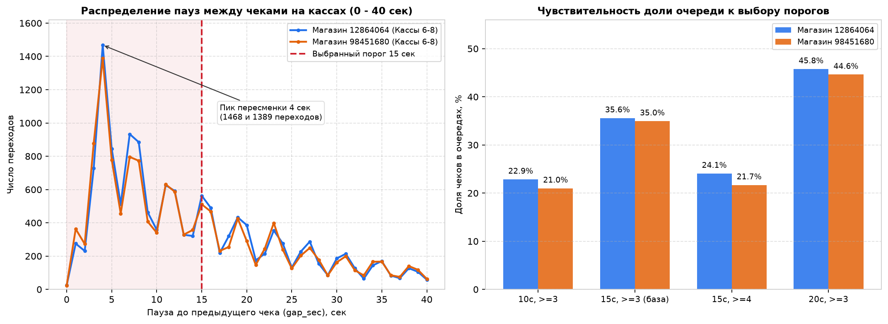
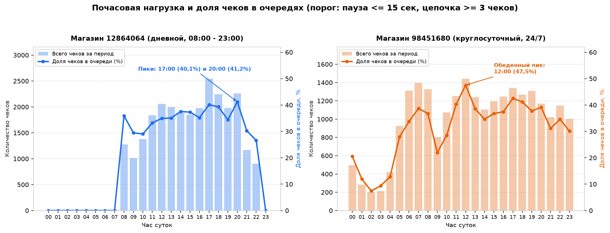
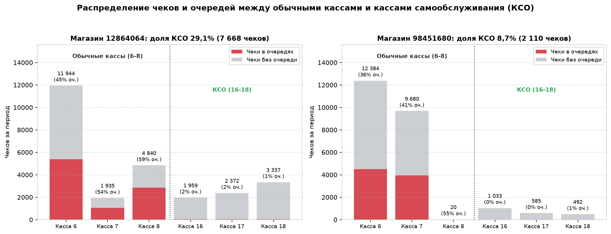
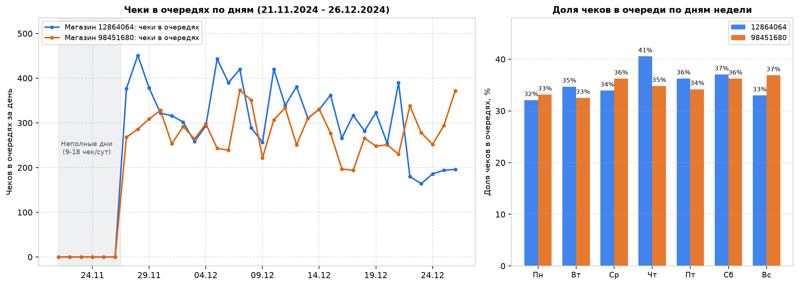

# Анализ очередей на кассах: тестовое задание Спутник

[](https://www.python.org/)
[](https://github.com/unnamed00bas/sputnik-data-analyst-test/actions/workflows/tests.yml)
[](LICENSE)

## О проекте

Это решение тестового задания на позицию «Ведущий аналитик данных» в компанию Спутник ([условия задания](https://sputnik.llc/technical_task/)). В задаче нужно объединить кассовые логи и справочник магазинов с помощью Power Query, отобрать два магазина (`98451680` и `12864064`), воспроизвести объединение и фильтр на SQL, а затем рассчитать периоды очередей на кассах, сохранив в Excel живые формулы без пересохранения в значения.

Все цифры и графики в этом репозитории получены кодом на Python и DuckDB из папки `src/`, проверены тестами `pytest`, а итоговая книга Excel с формулами лежит в [excel/sputnik_queues_solution.xlsx](excel/sputnik_queues_solution.xlsx).

## Исходные данные и аудит качества

В исходной папке с заданием находятся два CSV-файла:

- `store_stores.csv` (3,2 КБ, лежит в `data/store_stores.csv`): справочник из **68 магазинов** (`store_id`, `store_uuid`).
- `store_checkout_queues.csv` (109,3 МБ, **1 064 703 строки**): чеки за период с **21.11.2024 по 26.12.2024**. Из-за ограничения GitHub в 100 МБ полный сырой файл исключен из репозитория. Для автономного запуска в `data/filtered_queues.csv` сохранена отфильтрованная выборка по двум целевым магазинам (**50 581 чек**, 3,6 МБ).

Что показал первичный аудит данных:

1. **Целостность связки:** все 1 064 703 строки успешно соединяются со справочником по `store_uuid` (`0` несопоставленных записей, `0` дубликатов `store_id`).
2. **Гранулярность:** в выборке по целевым магазинам `50 581` строка и ровно `50 581` уникальный `checks_number`. То есть одна строка соответствует одному отдельному чеку (разбивки по позициям внутри чека нет).
3. **Расхождение в имени столбца:** в файле `store_checkout_queues.csv` номер кассы называется `checkout_id1`, тогда как итоговая таблица по условию требует имя `checkout_id`. Это переименование учтено и в Power Query, и в SQL.
4. **Неполные дни на старте периода:** с `21.11` по `26.11` (6 дней) в обоих магазинах фиксируется всего по `9 - 18` чеков в сутки. Полномасштабный поток (`642 - 1 065` чеков в день в `12864064` и `738 - 904` в `98451680`) начинается с `27.11.2024` (30 полных дней).
5. **Контекст по сети:** при медиане по всем 68 магазинам `14 497,5` чека целевые магазины входят в топ-10 самых загруженных точек сети: `12864064` на **3-м месте** (`26 387` чеков), `98451680` на **6-м месте** (`24 194` чека).

## Шаги 1 - 3: Power Query и SQL

### Power Query (M-код)

Скрипты лежат в [powerquery/store_stores.pq](powerquery/store_stores.pq) и [powerquery/store_checkout_queues.pq](powerquery/store_checkout_queues.pq), подробная инструкция описана в [powerquery/README.md](powerquery/README.md). Логика шагов:

1. Чтение `store_stores.csv` с приведением `store_id` к `Int64.Type`.
2. Чтение `store_checkout_queues.csv` и внутреннее объединение (`Table.NestedJoin`, `JoinKind.Inner`) по `store_uuid`.
3. Разворачивание `store_id`, переименование `checkout_id1 -> checkout_id`, отбор ровно 8 целевых полей в заданном порядке.
4. Парсинг дат `start_operation_dt` и `end_operation_dt` с локалью `"ru-RU"`, фильтрация по `store_id = 98451680 or store_id = 12864064` и сортировка `store_id -> checkout_id -> start_operation_dt`.

### SQL-запрос (шаг 3)

Полный запрос находится в [sql/01_merge_and_filter.sql](sql/01_merge_and_filter.sql):

```sql
SELECT
    scq.checks_number,
    ss.store_id,
    scq.employees_id,
    scq.quantity,
    scq.selling_price,
    scq.checkout_id1 AS checkout_id,
    scq.start_operation_dt,
    scq.end_operation_dt
FROM store_checkout_queues AS scq
INNER JOIN store_stores AS ss
    ON scq.store_uuid = ss.store_uuid
WHERE ss.store_id IN (98451680, 12864064)
ORDER BY
    ss.store_id,
    CAST(scq.checkout_id1 AS INTEGER),
    scq.start_operation_dt,
    scq.end_operation_dt,
    scq.checks_number;
```

## Шаг 4: методика определения периодов очереди

В кассовых логах есть моменты открытия (`start_operation_dt`) и закрытия (`end_operation_dt`) каждого чека, но нет времени прихода покупателя в очередь до начала сканирования. Поэтому очередь восстанавливается по паузе между последовательными чеками на одной и той же кассе:

$$\text{gap\_sec}_i = \text{start\_operation\_dt}_i - \text{end\_operation\_dt}_{i-1}$$

Ни на одной кассе чеки по времени не пересекаются (`min gap_sec = 0`). При наличии живой очереди следующий покупатель начинает пробивать товар сразу после ухода предыдущего, поэтому пауза `gap_sec` укладывается в короткий интервал пересменки:

1. Гистограмма пауз на обычных кассах показывает резкий пик на **3 - 5 секундах** (максимум ровно на `4 сек`: `1 468` переходов в `12864064` и `1 389` в `98451680`) и затухающую серию пиков каждые ~4 сек вплоть до `15 сек`. На кассах `6 - 8` медианная пауза составляет `16 сек` в `12864064` и `23 сек` в `98451680`.
2. Два чека с паузой до 15 сек могут оказаться рядом случайно, но **цепочка из 3 и более чеков подряд** (`chain_len >= 3`) с паузой `gap_sec <= 15 сек` в пределах одних суток означает непрерывный поток покупателей без простоев кассы.
3. Дополнительно на уровне всего магазина рассчитываются **15-минутные слоты**: слот считается периодом пиковой общемагазинной очереди, если в нем зафиксировано `>= 6` чеков в очередях (или очередь идет одновременно на 2 и более кассах). Смежные 15-минутные слоты склеиваются в непрерывные периоды очереди магазина.

SQL-реализация этого алгоритма вынесена в [sql/02_queue_periods.sql](sql/02_queue_periods.sql), а в книге Excel все пороги (`15 сек`, `3 чека`, `6 чеков / 15 мин`) вынесены на первый лист в ячейки параметров `C5:C7`.



### Проверка чувствительности порогов

| Порог паузы | Мин. длина цепочки | Магазин `12864064`: эпизодов / доля чеков | Магазин `98451680`: эпизодов / доля чеков |
|---|---|---|---|
| `10 сек` | `>= 3` | 1 586 эпизодов / **22,9 %** | 1 413 эпизодов / **21,0 %** |
| **`15 сек` (база)** | **`>= 3`** | **2 195 эпизодов / 35,6 %** | **2 100 эпизодов / 35,0 %** |
| `15 сек` | `>= 4` | 1 182 эпизода / **24,1 %** | 1 030 эпизодов / **21,7 %** |
| `20 сек` | `>= 3` | 2 491 эпизод / **45,8 %** | 2 465 эпизодов / **44,6 %** |

При любом разумном выборе порогов относительная картина между магазинами сохраняется, а при базовом сценарии (`15 сек`, `>= 3 чека`) доля чеков в очередях близка к 35 % в обеих точках, но природа этих очередей разная.

## Ключевые результаты

| Показатель | Магазин `12864064` | Магазин `98451680` |
|---|---|---|
| Режим работы | Дневной (`08:00 - 23:00`) | Круглосуточный (`24/7`) |
| Всего чеков (ранг в сети из 68) | **26 387** (3-е место) | **24 194** (6-е место) |
| Выручка за период, руб | 12 627 150 | 9 851 131 |
| Активных касс / сотрудников | 6 касс / 7 сотрудников | 6 касс / 4 сотрудника |
| Доля касс самообслуживания (КСО `16 - 18`) | **29,1 %** (`7 668` чеков) | **8,7 %** (`2 110` чеков) |
| Медиана / среднее время чека, сек | 43,0 / 59,4 | 31,0 / 46,5 |
| Чеков в очередях (порог `15 сек`, `>= 3`) | **9 391 (35,6 %)** | **8 456 (35,0 %)** |
| Эпизодов очереди на отдельных кассах | 2 195 (средний 4,21 мин) | 2 100 (средний 3,40 мин) |
| Самая длинная цепочка на кассе | **23 чека** (`19.12 20:40 - 20:55`, касса 6) | **15 чеков** (`30.11 19:57 - 20:12`, касса 6) |
| Пиковых 15-мин слотов (`>= 6` чеков в оч.) | 778 слотов (**194,5 часа**) | 639 слотов (**159,8 часа**) |
| Непрерывных периодов пиковой очереди | 321 период (до 345 мин) | 420 периодов (до 135 мин) |

### Главные выводы по данным

1. **Две разные зоны касс:** кассы `6, 7, 8` обслуживают живые кассиры (в `12864064` на обычные кассы приходится `49,5 %` чеков в очередях, в `98451680` это `38,3 %`). Кассы `16, 17, 18` работают под служебным `employees_id = 599`, это кассы самообслуживания (КСО). На отдельной стойке КСО клиенты дольше упаковывают покупки (медиана обслуживания `43 - 50 сек`, пауза между чеками на одном терминале `229 сек` в `12864064` и `1 649 сек` в `98451680`), поэтому локальных цепочек с паузой `<= 15 сек` на одном терминале КСО мало (`1,6 %` и `0,1 %`), хотя в часы пик `12864064` пропускает через КСО до `18 - 19` чеков за 15 минут.
2. **В магазине `98451680` зона КСО почти простаивает:** при сопоставимом с `12864064` потоке `91,2 %` всех чеков в `98451680` ложится всего на две обычные кассы (`6` - `12 384` чека, `7` - `9 680` чеков; касса `8` работала лишь на `20` чеках). В самые пиковые 15-минутки (`29.11 12:30` - `27` чеков, `08.12 11:00` - `24` чека) КСО в этом магазине обработали `0` чеков.
3. **Разные суточные пики нагрузки:**
   - Магазин `12864064` имеет два вечерних пика: **17:00 - 18:59** (`40,1 %` и `39,3 %` чеков в очередях) и **20:00 - 20:59** (`41,2 %`), а также утренний всплеск открытия в **08:00** (`35,9 %`). Пиковый 15-минутный слот: `18.12 20:30 - 20:45` (`43` чека за 15 минут). Самый напряженный день недели - **четверг** (`40,6 %`), затем **суббота** (`37,1 %`).
   - Магазин `98451680` работает круглосуточно: минимальная нагрузка ночью в **01:00 - 04:59** (`7,4 - 12,8 %`), затем утренняя волна в **06:00 - 08:59** (`33,7 - 38,7 %`), максимальный в обеих точках **обеденный пик в 12:00** (**`47,5 %` чеков в очередях**) и вечерний пик **17:00 - 18:59** (`42,5 %` и `41,2 %`).





## Рекомендации

1. **Перенаправить мелкие корзины на КСО в магазине `98451680`:** три установленных терминала `16, 17, 18` сейчас забирают только `8,7 %` чеков. При выводе дежурного консультанта к зоне КСО в утреннюю (`06:00 - 08:30`) и обеденную (`11:00 - 13:30`) волны долю КСО реально поднять до уровня `12864064` (`25 - 29 %`), что снимет до трети нагрузки с касс `6` и `7` без найма новых кассиров.
2. **Точечно усилить кассовые смены в пиковые окна:**
   - Для `12864064`: держать дополнительную кассу `7`/`8` открытой в окна **17:00 - 19:00** и **20:00 - 21:00**, особенно в **четверг** и **субботу**.
   - Для `98451680`: закрыть **обеденный провал пропускной способности в 11:30 - 13:30** (когда доля очередей достигает `47,5 %`) за счет совмещения смен или активации кассы `8`.
3. **Улучшить телеметрию для точного SLA ожидания:** текущая выгрузка фиксирует время обслуживания, но не момент подхода покупателя к кассе. Если добавить логирование начала сканирования первой позиции с датчиком зоны ожидания или видеоаналитикой, появится возможность измерять реальное время ожидания в секундах в дополнение к плотности чеков.

## Структура Excel-книги с живыми формулами

Файл [excel/sputnik_queues_solution.xlsx](excel/sputnik_queues_solution.xlsx) содержит 6 листов и **0 ошибок формул** (проверено пересчетом в LibreOffice Calc):

- `Описание_и_логика`: параметры модели (`C5 = 15` сек, `C6 = 3` чека, `C7 = 6` чеков за 15 мин) и методика расчета.
- `Сводка_по_магазинам`: KPI по магазинам и зонам (`Касса` / `КСО`) через `COUNTIFS`, `SUMIFS`, `AVERAGEIFS`.
- `Часы_и_зоны`: почасовая таблица на `COUNTIFS` и встроенный график.
- `Эпизоды_очередей`: все `4 295` эпизодов очередей на кассах с расчетом длительности формулами.
- `Слоты_15мин`: все `4 714` активных 15-минутных интервалов, агрегированных формулами по целочисленному ключу слота, с выделением начала непрерывного периода очереди.
- `Данные_и_расчет`: все `50 581` строка выборки и 9 расчетных столбцов на формулах (`I:Q`), включая расчет длины непрерывной цепочки за `O(1)` на строку без тяжелых диапазонных `COUNTIF`.

Примечание по окружению: так как сборка проекта выполнялась в Linux, M-скрипты Power Query сохранены отдельно в папке `powerquery/`, а таблица `Данные_и_расчет` и все формульные листы собраны скриптом `src/sputnik_case/excel_builder.py` и верифицированы через LibreOffice.

## Как запустить локально

```bash
git clone https://github.com/unnamed00bas/sputnik-data-analyst-test.git
cd sputnik-data-analyst-test
pip install -r requirements.txt
python run_all.py
pytest -v
```

Если положить исходные CSV (`store_stores.csv` и `store_checkout_queues.csv`) в папку `../raw`, скрипт автоматически выполнит объединение напрямую по полным файлам через `sql/01_merge_and_filter.sql` и выведет аудит по всем 68 магазинам. Без них скрипт использует готовую выборку `data/filtered_queues.csv`.

## Структура репозитория

```text
├── .github/workflows/tests.yml
├── LICENSE
├── README.md
├── run_all.py
├── requirements.txt
├── pytest.ini
├── data/
│   ├── store_stores.csv                  # справочник 68 магазинов
│   └── filtered_queues.csv               # выборка по магазинам 98451680 и 12864064 (50 581 чек)
├── powerquery/
│   ├── README.md                         # шаги и пояснение логики Power Query
│   ├── store_stores.pq                   # M-код загрузки справочника
│   └── store_checkout_queues.pq          # M-код объединения, переименования и фильтрации
├── sql/
│   ├── 01_merge_and_filter.sql           # точный SQL-запрос для шага 3 (алиасы scq и ss)
│   └── 02_queue_periods.sql              # аналитический SQL-запрос определения очередей (шаг 4)
├── excel/
│   └── sputnik_queues_solution.xlsx      # книга Excel с живыми формулами
├── reports/figures/                      # 4 аналитических графика PNG
├── src/sputnik_case/
│   ├── data_loader.py                    # загрузка данных и аудит сети
│   ├── queues.py                         # расчет цепочек очередей, слотов и чувствительности
│   ├── charts.py                         # генерация графиков
│   └── excel_builder.py                  # сборка книги Excel с формулами
└── tests/
    └── test_pipeline.py                  # автотесты паритета SQL/Python и живых формул Excel
```

## Контакты

Марина Погодина, Telegram [@Marinochcin](https://t.me/Marinochcin), GitHub [@unnamed00bas](https://github.com/unnamed00bas).

---

## English summary

My solution to the Lead Data Analyst take-home assignment for Sputnik. The task combines `store_checkout_queues.csv` (1.06M rows across 68 stores) and `store_stores.csv`, filters stores `98451680` and `12864064` (50,581 receipts), reproduces the merge and filtering in both Power Query M and SQL (`scq` / `ss` aliases), and identifies checkout queue periods in Excel using live formulas without hardcoding values. Using empirical inter-receipt gap histograms (`gap_sec <= 15s`, streak `>= 3` receipts) and 15-minute store load buckets, the analysis shows ~35% queue share in both stores driven by different bottlenecks: evening rush waves (`17:00` and `20:00`) in daytime store `12864064` (29.1% SCO adoption) versus severe SCO underutilization (8.7% share) and a `47.5%` lunchtime queue peak (`12:00`) in 24/7 store `98451680`. All numbers are verified by DuckDB SQL and `pytest`.
